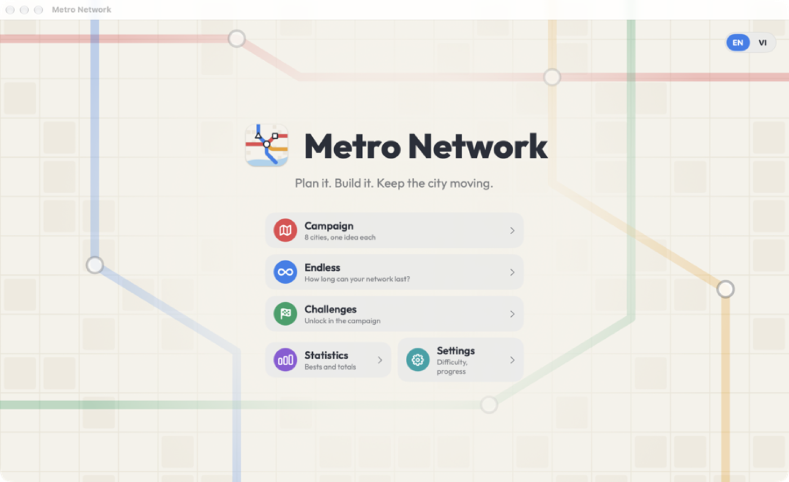

# Metro Network

An original transit-network strategy puzzle game for **macOS and iOS** (iPhone + iPad), built with Swift 6,
SwiftUI and SpriteKit. Connect stations with metro lines, run trains, carry passengers to the shapes they want,
and keep a growing city moving with a limited weekly budget. Single player, fully offline, no accounts, no
tracking, no third-party code. **English and Vietnamese** (switch with **EN | VI** on the main menu).

| | | |
|---|---|---|
|  |  |  |

- **Campaign:** 8 cities, each introducing one idea (tunnels, carriages, rush hours, express lines, events…), with 3 stars per level.
- **Endless:** how long can your network last? Easy, Normal or Hard, on 5 cities plus random ones.
- **Challenges:** 5 fixed scenarios with one unusual rule each, for bronze, silver and gold.
- Weekly depot (trains, carriages, lines, tunnels, station expansions, fast motors), rush hours, network events,
  special stations, a live network-efficiency score, four map themes, sound effects and generated music.

## Install (macOS)

1. Download **`MetroNetwork-<version>-macOS.zip`** from the
   [latest release](https://github.com/anhkhoi102/MetroNetwork/releases/latest).
   It runs on macOS 14 Sonoma or later, on Apple Silicon and Intel Macs.
2. Double-click the zip to unpack it and drag **Metro Network** into your **Applications** folder.
3. The app is not notarised by Apple (it is built without a paid developer account), so the first time:
   - **Right-click** (or Control-click) **Metro Network → Open**, then click **Open** in the dialog; or
   - if macOS only offers *Move to Trash*: open **System Settings → Privacy & Security**, scroll down and click
     **Open Anyway** next to "Metro Network", then open the app again.

   After the first time it opens normally. If you prefer the Terminal, this removes the download flag instead:

   ```bash
   xattr -dr com.apple.quarantine "/Applications/Metro Network.app"
   ```

4. Optional: check the download against the `.sha256` file published with the release:

   ```bash
   shasum -a 256 MetroNetwork-1.0.0-macOS.zip
   ```

Your progress is saved on your Mac only (see [Saving](#saving)). To uninstall, delete the app; to also remove
progress, delete `~/Library/Containers/io.github.metronetwork.game`.

## Install (iPhone / iPad)

Apple only allows apps on an iPhone or iPad through the App Store or a developer build, so there is no
download for iOS. You can install it from source with a free Apple ID:

1. On a Mac with **Xcode 27** or later, clone this repository and open `MetroNetwork.xcodeproj`.
2. Select the **MetroNetwork** target → **Signing & Capabilities**, choose your own **Team** (a free personal team
   works) and change the **Bundle Identifier** to something unique, e.g. `com.yourname.metronetwork`.
3. Connect your iPhone or iPad (iOS / iPadOS 17 or later), pick it as the run destination and press **Run** (⌘R).
4. On the device: **Settings → General → VPN & Device Management** → trust your developer certificate.
   (With a free Apple ID the app must be reinstalled from Xcode every 7 days.)

You can also run it in the iOS Simulator without any signing: pick a simulator and press Run.

## Hướng dẫn cài đặt (Tiếng Việt)

**macOS**

1. Tải **`MetroNetwork-<phiên bản>-macOS.zip`** ở mục [Releases](https://github.com/anhkhoi102/MetroNetwork/releases/latest)
   (cần macOS 14 trở lên; chạy được trên cả Mac chip Apple và Mac Intel).
2. Mở file zip rồi kéo **Metro Network** vào thư mục **Applications**.
3. Vì app không được Apple công chứng (notarise), lần đầu hãy **chuột phải → Open → Open**. Nếu macOS chỉ cho
   *Move to Trash*: vào **System Settings → Privacy & Security**, kéo xuống bấm **Open Anyway**, rồi mở lại app.
   Hoặc chạy lệnh `xattr -dr com.apple.quarantine "/Applications/Metro Network.app"` trong Terminal.
4. Chọn tiếng Việt bằng nút **EN | VI** ở góc trên menu chính.

**iPhone / iPad:** cần build từ mã nguồn bằng Xcode (xem phần *Install (iPhone / iPad)* ở trên): chọn Team của
bạn (Apple ID miễn phí cũng được), đổi Bundle Identifier, cắm máy và bấm Run.

## Build from source


| | Command |
|---|---|
| macOS app → `build/MetroNetwork.app` | `Scripts/build.sh` (`debug` for a debug build, `--open` to launch) |
| Downloadable universal zip → `dist/` | `Scripts/package-macos.sh` |
| iOS Simulator build | `Scripts/build-ios.sh` |
| All tests via Xcode scheme | `Scripts/test.sh` |
| Core logic tests only (fast) | `swift test --package-path Packages/MetroCore` |
| Regenerate app icon and menu logo | `swift Tools/make-icon.swift` |
| Self-playing demo for screenshots (Debug builds) | `build/MetroNetwork.app/Contents/MacOS/MetroNetwork -MetroDemo 0` (add `-MetroDemoAuto -MetroDemoSpeed 4` to let the auto player run it fast, `-MetroDemoScenario c1-first-line` for a campaign level; other flags in `DemoDirector.swift`) |

Or open `MetroNetwork.xcodeproj` and pick the *My Mac* or an iPhone/iPad simulator destination — it is one
multiplatform target. Requirements: Xcode 27, macOS 14+ / iOS 17+. Running on a physical iPhone needs your
own signing team in the target settings (see above).

More documentation:
- [Docs/PHASES.md](Docs/PHASES.md): what was built in each development phase.
- [Docs/ARCHITECTURE.md](Docs/ARCHITECTURE.md): architecture, data models, risks.
- [Docs/TEST_REPORT.md](Docs/TEST_REPORT.md): test results.
- [THIRD_PARTY_ASSETS.md](THIRD_PARTY_ASSETS.md): fonts, textures and sounds with their licenses (OFL, CC0).

## Controls

| Action | macOS | iOS |
|---|---|---|
| New line | drag from a station through others | same, one finger |
| Extend / shorten a line | drag its end handle (T-bar) onto stations / back along the line | same |
| Close a loop | drag the end onto the line's first station | same |
| Insert a station | drag the middle of a segment onto the station | same |
| Select station / line / train | click | tap |
| Add / withdraw trains | line card −/+ (uses spare trains), or train card → Withdraw | same |
| Depot (spend weekly credits) | ticket button or `D` | ticket button |
| Carriages, fast motor | train card | same |
| Expand a station | station card → Expand | same |
| Express service | line card → Express switch | same |
| Efficiency breakdown | click the efficiency capsule under the HUD | tap it |
| Level objectives | click the ★ capsule under the HUD | tap it |
| Pan | drag empty map, right-drag, or two-finger scroll | drag empty map or two-finger pan |
| Zoom | pinch, mouse wheel, ⌘-scroll, `+` / `-` | pinch |
| Fit city | `F` or the magnifier button | magnifier button |
| Pause / speed | `Space` / `Tab` | buttons |
| Delete selected line | `Delete` | card button |
| Select line 1–7 / cancel | `1`–`7` / `Esc` (also closes the depot) | line dots / ✕ |

## Layout

```
Packages/MetroCore    pure-Swift game logic + Swift Testing unit tests (no UI frameworks)
MetroNetwork/         app: SwiftUI shell, SpriteKit scene, renderers, platform input views
SupportingFiles/      Info.plists and entitlements
Scripts/              build and test scripts
Docs/                 architecture and phase status
```

## Saving

Progress (`progress.json`) and the game in progress (`session.json`) are stored in Application Support/Metro Network
(inside the app's sandbox container on macOS). The game in progress is saved every 20 s, at each new week, when the app
goes to the background and when you leave to the menu; **Continue** on the menu resumes it.

## License

The source code is released under the [MIT License](LICENSE). Bundled third-party assets keep their own
licenses: the Outfit font (SIL Open Font License 1.1) and Kenney textures and sounds (CC0); see
[THIRD_PARTY_ASSETS.md](THIRD_PARTY_ASSETS.md).

Mã nguồn được phát hành theo giấy phép MIT: bạn có thể dùng, sửa và phân phối lại, miễn giữ thông báo bản
quyền. Phông chữ và âm thanh/hình ảnh bên thứ ba theo giấy phép riêng (OFL, CC0).
