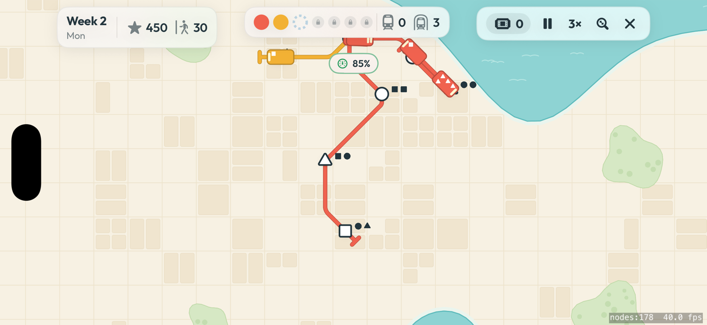
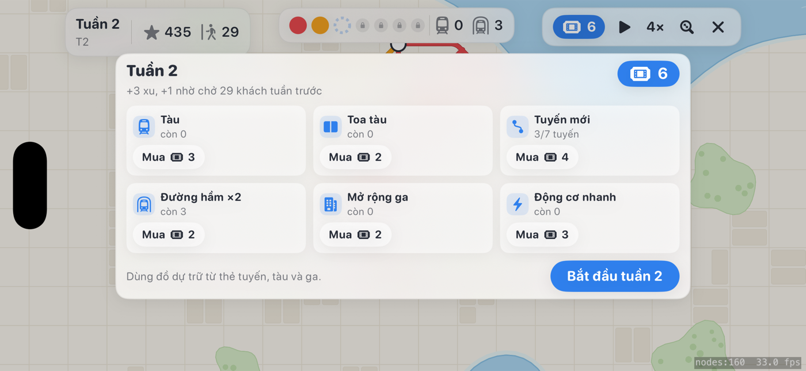

# Metro Network

An original transit-network strategy puzzle game for **macOS and iOS** (iPhone + iPad), built with Swift 6,
SwiftUI and SpriteKit. Connect stations with metro lines, run trains, carry passengers to the shapes they want,
and keep a growing city moving with a limited weekly budget. Single player, fully offline, no accounts, no
tracking, no third-party code. **English and Vietnamese** (switch with **EN | VI** on the main menu).

| | | |
|---|---|---|
|  |  |  |

- **Campaign:** 10 cities, each introducing one idea (tunnels, carriages, rush hours, express lines, events, a stadium, an airport…), with 3 stars per level.
- **Endless:** how long can your network last? Easy, Normal or Hard, on 5 cities plus random ones.
- **Challenges:** 5 fixed scenarios with one unusual rule each, for bronze, silver and gold.
- Weekly depot (trains, carriages, lines, tunnels, station expansions, fast motors), rush hours, network events,
  special stations, a live network-efficiency score, four map themes, sound effects and generated music.

New to the game? Read [How to play](#how-to-play) · [Cách chơi](#cách-chơi-tiếng-việt).

## Install (macOS)

1. Download **`MetroNetwork-<version>-macOS.zip`** from the
   [latest release](https://github.com/anhkhoi102/MetroNetwork/releases/latest).
   It runs on macOS 14 Sonoma or later, on Apple Silicon and Intel Macs.
2. Double-click the zip to unpack it and drag **Metro Network** into your **Applications** folder.
3. The app is not notarised by Apple (it is built without a paid developer account), so the first time:
   - **Right-click** (or Control-click) **Metro Network → Open**, then click **Open** in the dialog; or
   - if macOS only offers *Move to Trash*: open **System Settings → Privacy & Security**, scroll down and click
     **Open Anyway** next to "Metro Network", then open the app again.

   After the first time it opens normally. If you prefer the Terminal, this removes the download flag instead:

   ```bash
   xattr -dr com.apple.quarantine "/Applications/Metro Network.app"
   ```

4. Optional: check the download against the `.sha256` file published with the release:

   ```bash
   shasum -a 256 MetroNetwork-*-macOS.zip
   ```

Your progress is saved on your Mac only (see [Saving](#saving)). To uninstall, delete the app; to also remove
progress, delete `~/Library/Containers/io.github.metronetwork.game`.

## Install (iPhone / iPad)

Apple only allows apps on an iPhone or iPad through the App Store or a developer build, so there is no
download for iOS. You can install it from source with a free Apple ID:

1. On a Mac with **Xcode 27** or later, clone this repository and open `MetroNetwork.xcodeproj`.
2. Select the **MetroNetwork** target → **Signing & Capabilities**, choose your own **Team** (a free personal team
   works) and change the **Bundle Identifier** to something unique, e.g. `com.yourname.metronetwork`.
3. Connect your iPhone or iPad (iOS / iPadOS 17 or later), pick it as the run destination and press **Run** (⌘R).
4. On the device: **Settings → General → VPN & Device Management** → trust your developer certificate.
   (With a free Apple ID the app must be reinstalled from Xcode every 7 days.)

You can also run it in the iOS Simulator without any signing: pick a simulator and press Run.

## Hướng dẫn cài đặt (Tiếng Việt)

**macOS**

1. Tải **`MetroNetwork-<phiên bản>-macOS.zip`** ở mục [Releases](https://github.com/anhkhoi102/MetroNetwork/releases/latest)
   (cần macOS 14 trở lên; chạy được trên cả Mac chip Apple và Mac Intel).
2. Mở file zip rồi kéo **Metro Network** vào thư mục **Applications**.
3. Vì app không được Apple công chứng (notarise), lần đầu hãy **chuột phải → Open → Open**. Nếu macOS chỉ cho
   *Move to Trash*: vào **System Settings → Privacy & Security**, kéo xuống bấm **Open Anyway**, rồi mở lại app.
   Hoặc chạy lệnh `xattr -dr com.apple.quarantine "/Applications/Metro Network.app"` trong Terminal.
4. Chọn tiếng Việt bằng nút **EN | VI** ở góc trên menu chính.

**iPhone / iPad:** cần build từ mã nguồn bằng Xcode (xem phần *Install (iPhone / iPad)* ở trên): chọn Team của
bạn (Apple ID miễn phí cũng được), đổi Bundle Identifier, cắm máy và bấm Run.

## How to play

**Goal:** carry passengers to a station of the shape they want, and never let a station stay overcrowded for
too long. The city keeps growing and demand keeps rising, while your resources are limited. (Numbers below
are for Normal difficulty.)

### Rules

- **Stations and passengers.** Every station has a shape (circle, triangle, square; later diamond, star,
  hexagon). The small shape next to a waiting passenger is the *kind* of station they want: any station of that
  shape will do. Passengers plan their own route, change trains at stations shared by several lines, and prefer
  lines whose trains come often.
- **Building lines.** Drag from a station through others to build a line; each new line takes a spare train.
  Drag a line's end (the T-bar) to extend it, drag the middle of a segment onto a station to insert it, drag the
  end back onto the first station to make a loop. A line that crosses water needs a **tunnel** (you start with 3).
- **Losing.** A station holds 12 passengers. Beyond that an **overcrowding ring** fills around it (amber, then
  red); when it is full after 50 s, the game ends. The ring drains when the queue shrinks. An "!" arrow at the
  edge of the screen points to a crowded station that is out of view.
- **Weeks and the depot.** Every week (90 s) the game pauses and opens the **depot**: you get 3 credits, plus 1
  for every 20 passengers delivered that week (up to +3). Unspent credits are kept. Items wait in stock until you
  use them from a line, train or station card.

  | Item | Price |
  |---|---|
  | Carriage (+4 seats, the train accelerates more slowly) | 2 |
  | 2 tunnels | 2 |
  | Station expansion (+8 room) | 2 |
  | Train | 3 |
  | Fast motor (+35 % speed) | 3 |
  | New line | 4 |

- **Score.** 10 points per passenger, plus up to 5 for a quick trip (full bonus up to 30 s, none from 90 s).
- **Later on** (from week 3–4):
  - **Rush hours:** mornings the outskirts get busy, evenings the centre; the depot tells you which days.
  - **Network events**, each announced 8 s ahead: crowds, tour groups, train maintenance, station closures.
  - **Special stations:** a *hub* has many passengers, an *interchange* makes changing trains fast, a
    *heritage* station allows at most 2 lines, a *grand* station is roomy but can't be expanded.
  - **Express lines** stop only at line ends, interchanges and special stations.
- **Venues** (campaign levels 9 and 10): at full time on Wednesdays and Saturdays a *stadium* sends 12 fans
  out at once; *airport* travellers give up after 45 s on a platform and earn +10 if they arrive within 60 s.

### Tips

**Building the network**
1. **Give every line all three basic shapes** (circle, triangle, square), so most passengers ride straight
   through without changing.
2. **Make lines cross at stations**, not just near each other, so passengers can change trains. Interchange
   stations are the best crossing points.
3. **Short, straight lines beat long winding ones:** faster trips, bonus points and quicker train turnaround.
   For a long line, consider a loop or express service.
4. **Connect rare shapes (star, diamond, hexagon) early**: passengers for them usually travel far. Fit fast
   motors to the trains that carry them.

**Spending credits**
5. **Add trains before adding lines.** A busy line with one train makes passengers wait and stations fill up.
   Adding trains (up to 4 per line) is usually better value than a new line (the most expensive item).
6. **Depot priorities:** trains for the busiest line, then carriages for trains that run full; keep 2 credits
   for an emergency station expansion; buy tunnels only when you need to cross water.

**When a station turns red** (in this order)
7. Add a train or a carriage to a line through it.
8. Connect a second line to it.
9. Expand the station to buy time.
10. If an express line skips it, switch express off.

**Planning ahead**
11. **Rush hours:** check the depot for the days. Before a morning rush, add capacity to lines coming in from
    the outskirts; before an evening rush, to lines leaving the centre.
12. **Pause to think:** `Space` on the Mac, ⏸ on iPhone. You can edit lines while paused.
13. **Use the efficiency score:** click or tap the % capsule under the top bar. It shows the weakest part
    (waiting, trip time, empty seats or crowding) and suggests a fix.

**Where to start:** play the **Campaign** from level 1. Each level teaches one thing, and you pass by meeting
its first objective. Passing levels unlocks more Endless cities, Hard difficulty, challenges and map themes.

## Cách chơi (Tiếng Việt)

**Mục tiêu:** chở hành khách tới đúng loại ga họ muốn, và không để ga nào bị quá tải quá lâu. Thành phố lớn dần,
khách đông dần, còn tài nguyên thì có hạn. (Các con số dưới đây là của mức Thường.)

### Luật chơi

- **Ga và hành khách.** Mỗi ga có một hình dạng (tròn, tam giác, vuông; về sau có thêm thoi, sao, lục giác).
  Biểu tượng nhỏ cạnh mỗi khách là **loại ga họ muốn tới**: ga nào có hình đó cũng được. Khách tự tìm đường, biết
  đổi tàu ở ga có nhiều tuyến đi qua và chọn tuyến có tàu tới thường xuyên.
- **Xây tuyến.** Kéo từ ga này qua các ga khác để tạo tuyến; mỗi tuyến mới lấy một tàu dự trữ. Kéo đầu tuyến (thanh
  chữ T) để kéo dài, kéo vào giữa một đoạn để chèn ga, kéo về ga đầu tiên để thành tuyến vòng. Tuyến qua mặt nước
  cần **đường hầm** (lúc đầu có 3).
- **Thua khi nào.** Mỗi ga chứa được 12 khách. Vượt quá, quanh ga hiện **vòng quá tải** (vàng rồi đỏ); vòng đầy sau
  50 giây là thua. Ga bớt đông thì vòng rút dần. Mũi tên "!" ở mép màn hình chỉ tới ga quá tải nằm ngoài khung nhìn.
- **Tuần và Kho.** Mỗi tuần (90 giây) game dừng lại và mở **Kho**: bạn nhận 3 xu, cộng 1 xu cho mỗi 20 khách đã chở
  trong tuần (thưởng tối đa 3 xu). Xu chưa tiêu được giữ lại. Đồ đã mua nằm trong kho, dùng từ thẻ tuyến, tàu hoặc ga.

  | Món | Giá |
  |---|---|
  | Toa tàu (+4 chỗ, tàu tăng tốc chậm hơn) | 2 |
  | 2 đường hầm | 2 |
  | Mở rộng ga (+8 chỗ) | 2 |
  | Tàu | 3 |
  | Động cơ nhanh (+35% tốc độ) | 3 |
  | Tuyến mới | 4 |

- **Điểm.** Mỗi khách 10 điểm, cộng tối đa 5 điểm nếu chuyến đi nhanh (dưới 30 giây được trọn 5, từ 90 giây thì không).
- **Về sau** (từ tuần 3 – 4):
  - **Giờ cao điểm:** buổi sáng ngoại ô đông, buổi tối trung tâm đông; Kho báo trước những ngày nào.
  - **Sự cố**, mỗi sự cố báo trước 8 giây: đám đông, đoàn du lịch, tàu bảo dưỡng, ga đóng cửa.
  - **Ga đặc biệt:** *ga đầu mối* rất đông khách, *ga trung chuyển* đổi tàu rất nhanh, *ga di sản* tối đa 2 tuyến,
    *ga lớn* rất rộng nhưng không mở rộng được.
  - **Tàu tốc hành** chỉ dừng ở hai đầu tuyến, ga trung chuyển và ga đặc biệt.
- **Sân vận động và sân bay** (màn 9 và 10): mỗi thứ Tư và thứ Bảy, khi hết trận *sân vận động* thả 12 cổ động
  viên ra cùng lúc; du khách từ *sân bay* bỏ đi sau 45 giây chờ ở sân ga, và được +10 điểm nếu tới nơi trong 60 giây.

### Mẹo chơi tốt

**Xây mạng**
1. **Mỗi tuyến nên đi qua đủ ba loại ga** (tròn, tam giác, vuông), để phần lớn khách đi một mạch, không phải đổi tàu.
2. **Cho các tuyến cắt nhau ngay tại ga**, không chỉ đi sát nhau, để khách đổi tàu được. Ga trung chuyển là điểm giao
   tốt nhất.
3. **Tuyến ngắn, thẳng tốt hơn tuyến dài ngoằn ngoèo:** đi nhanh hơn, được thưởng điểm, tàu quay vòng nhanh. Tuyến dài
   thì cân nhắc làm tuyến vòng hoặc bật tốc hành.
4. **Nối ga hiếm (sao, thoi, lục giác) sớm**, vì khách tới đó thường đi xa. Lắp động cơ nhanh cho tuyến chở họ.

**Tiêu xu**
5. **Thêm tàu trước khi thêm tuyến.** Tuyến đông mà chỉ 1 tàu thì khách chờ lâu, ga nhanh đầy. Thêm tàu (tối đa 4 mỗi
   tuyến) thường lợi hơn mở tuyến mới (đắt nhất).
6. **Thứ tự mua ở Kho:** tàu cho tuyến đông nhất, rồi toa cho tàu hay chạy đầy; để dành 2 xu mở rộng ga phòng lúc nguy
   cấp; chỉ mua đường hầm khi thật cần qua sông.

**Khi có ga đỏ** (theo thứ tự)
7. Thêm tàu hoặc nối toa cho tuyến qua ga đó.
8. Nối thêm một tuyến thứ hai vào ga đó.
9. Mở rộng ga để có thêm thời gian.
10. Nếu ga đang bị tuyến tốc hành bỏ qua, tắt tốc hành.

**Chuẩn bị trước**
11. **Giờ cao điểm:** xem Kho để biết ngày nào. Trước cao điểm sáng, tăng sức chở cho tuyến từ ngoại ô vào; trước
    cao điểm tối thì ngược lại.
12. **Tạm dừng để tính:** `Space` trên Mac, nút ⏸ trên iPhone. Khi tạm dừng vẫn sửa tuyến được.
13. **Xem chỉ số hiệu suất:** bấm vào ô % dưới thanh trên cùng. Game chỉ ra điểm yếu nhất (chờ lâu, đi chậm, tàu
    vắng hay ga đông) và gợi ý cách sửa.

**Nên bắt đầu thế nào:** chơi **Chiến dịch** từ màn 1. Mỗi màn dạy một thứ; qua màn chỉ cần đạt mục tiêu đầu tiên.
Qua màn sẽ mở khoá thêm thành phố cho chế độ Vô tận, mức Khó, các thử thách và giao diện bản đồ.

## Build from source


| | Command |
|---|---|
| macOS app → `build/MetroNetwork.app` | `Scripts/build.sh` (`debug` for a debug build, `--open` to launch) |
| Downloadable universal zip → `dist/` | `Scripts/package-macos.sh` |
| iOS Simulator build | `Scripts/build-ios.sh` |
| All tests via Xcode scheme | `Scripts/test.sh` |
| Core logic tests only (fast) | `swift test --package-path Packages/MetroCore` |
| Regenerate app icon and menu logo | `swift Tools/make-icon.swift` |
| Self-playing demo for screenshots (Debug builds) | `build/MetroNetwork.app/Contents/MacOS/MetroNetwork -MetroDemo 0` (add `-MetroDemoAuto -MetroDemoSpeed 4` to let the auto player run it fast, `-MetroDemoScenario c1-first-line` for a campaign level; other flags in `DemoDirector.swift`) |

Or open `MetroNetwork.xcodeproj` and pick the *My Mac* or an iPhone/iPad simulator destination — it is one
multiplatform target. Requirements: Xcode 27, macOS 14+ / iOS 17+. Running on a physical iPhone needs your
own signing team in the target settings (see above).

More documentation:
- [Docs/PHASES.md](Docs/PHASES.md): what was built in each development phase.
- [Docs/ARCHITECTURE.md](Docs/ARCHITECTURE.md): architecture, data models, risks.
- [Docs/TEST_REPORT.md](Docs/TEST_REPORT.md): test results.
- [THIRD_PARTY_ASSETS.md](THIRD_PARTY_ASSETS.md): fonts, textures and sounds with their licenses (OFL, CC0).

## Controls

| Action | macOS | iOS |
|---|---|---|
| New line | drag from a station through others | same, one finger |
| Extend / shorten a line | drag its end handle (T-bar) onto stations / back along the line | same |
| Close a loop | drag the end onto the line's first station | same |
| Insert a station | drag the middle of a segment onto the station | same |
| Select station / line / train | click | tap |
| Add / withdraw trains | line card −/+ (uses spare trains), or train card → Withdraw | same |
| Depot (spend weekly credits) | ticket button or `D` | ticket button |
| Carriages, fast motor | train card | same |
| Expand a station | station card → Expand | same |
| Express service | line card → Express switch | same |
| Efficiency breakdown | click the efficiency capsule under the HUD | tap it |
| Level objectives | click the ★ capsule under the HUD | tap it |
| Pan | drag empty map, right-drag, or two-finger scroll | drag empty map or two-finger pan |
| Zoom | pinch, mouse wheel, ⌘-scroll, `+` / `-` | pinch |
| Fit city | `F` or the magnifier button | magnifier button |
| Pause / speed | `Space` / `Tab` | buttons |
| Delete selected line | `Delete` | card button |
| Select line 1–7 / cancel | `1`–`7` / `Esc` (also closes the depot) | line dots / ✕ |

## Layout

```
Packages/MetroCore    pure-Swift game logic + Swift Testing unit tests (no UI frameworks)
MetroNetwork/         app: SwiftUI shell, SpriteKit scene, renderers, platform input views
SupportingFiles/      Info.plists and entitlements
Scripts/              build and test scripts
Docs/                 architecture and phase status
```

## Saving

Progress (`progress.json`) and the game in progress (`session.json`) are stored in Application Support/Metro Network
(inside the app's sandbox container on macOS). The game in progress is saved every 20 s, at each new week, when the app
goes to the background and when you leave to the menu; **Continue** on the menu resumes it.

## License

The source code is released under the [MIT License](LICENSE). Bundled third-party assets keep their own
licenses: the Outfit font (SIL Open Font License 1.1) and Kenney textures and sounds (CC0); see
[THIRD_PARTY_ASSETS.md](THIRD_PARTY_ASSETS.md).

Mã nguồn được phát hành theo giấy phép MIT: bạn có thể dùng, sửa và phân phối lại, miễn giữ thông báo bản
quyền. Phông chữ và âm thanh/hình ảnh bên thứ ba theo giấy phép riêng (OFL, CC0).
